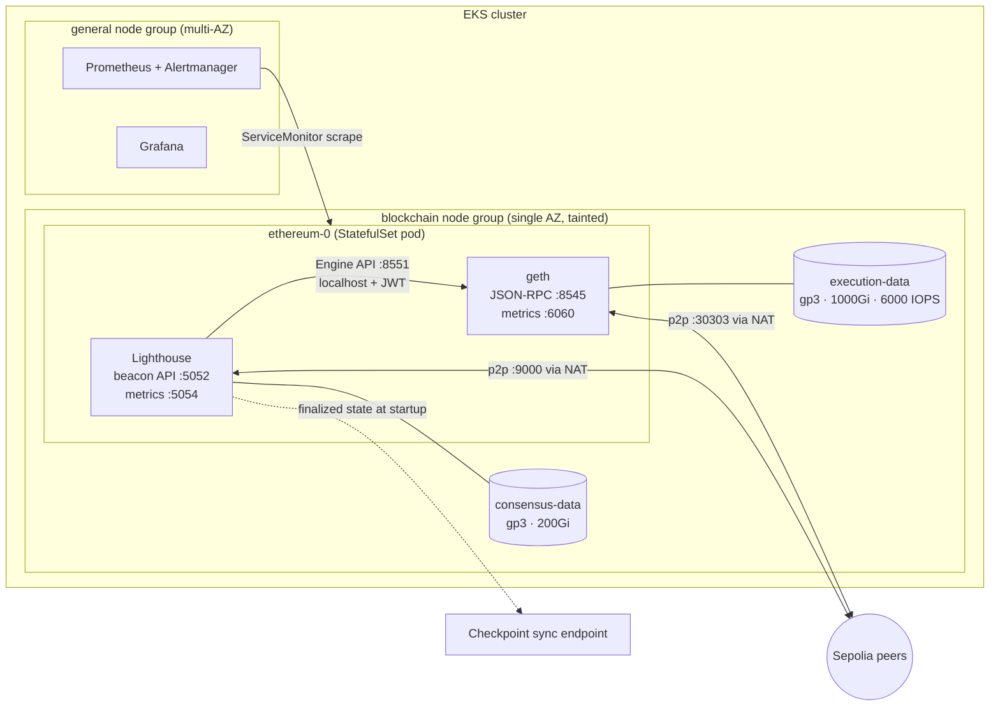

# stateful-node-on-eks

Running an Ethereum node (Sepolia testnet) on Amazon EKS the way you'd run any stateful, disk-heavy, network-sensitive system in production: a StatefulSet with per-client persistent volumes, a dedicated single-AZ node pool, tuned resources and graceful shutdown, and Prometheus monitoring with alerts on the symptoms that matter.

Since the Merge, an Ethereum node is two cooperating processes. **geth** (execution client) holds state and serves JSON-RPC. **Lighthouse** (consensus client) follows the beacon chain and drives geth through the authenticated Engine API. Running them together is a small distributed-systems problem in its own right.

## Architecture



## What it demonstrates

| Concern | How it's handled |
| --- | --- |
| Stable identity | StatefulSet with a headless Service: the pod is always `ethereum-0`, with the same DNS name and the same volumes across restarts and reschedules |
| Storage | One PVC per client from `volumeClaimTemplates`; gp3 with provisioned IOPS (sync is IOPS-bound); `WaitForFirstConsumer` so volumes are created in the pod's AZ; online expansion enabled |
| Zonal volumes | The node group is pinned to one AZ, so a replacement node can always reattach the EBS volumes |
| Isolation | Dedicated, tainted node group; only the node pod tolerates it |
| Resources | Requests and limits sized for sync; `GOMEMLIMIT` so geth's garbage collector works before the memory limit, not after |
| Safe restarts | 300-second termination grace so both clients flush state; startup probes so hours of initial sync aren't mistaken for a hang; `fsGroupChangePolicy: OnRootMismatch` to skip recursive chowns of a huge volume |
| Security | Engine API bound to localhost with a JWT secret; RPC is ClusterIP only; non-root containers with all capabilities dropped; encrypted volumes; EBS CSI driver credentials scoped to its service account through Pod Identity |
| Fast start | Lighthouse checkpoint-syncs from a recent finalized state instead of replaying from genesis |
| Monitoring | ServiceMonitors for both clients; alerts for a stalled head, low peers, a volume under 15% free, and a volume projected to fill within 24 hours |
| Operations | Phase-based PowerShell deploy and teardown, a sync-status script, and a [runbook](docs/runbook.md) for common tasks |

## Repository layout

```
terraform/              VPC, EKS, EBS CSI driver (Pod Identity), kube-prometheus-stack
k8s/                    Kustomize: StorageClass, StatefulSet, Services, ServiceMonitor, PrometheusRule
scripts/
  Deploy.ps1            Infra → Secret → Node
  Get-SyncStatus.ps1    Sync progress and peer counts for both clients
  Teardown.ps1          Node (including PVCs and volumes) → Infra
docs/
  design-notes.md       Decisions, trade-offs, and failure modes
  runbook.md            Day-2 operations: sync checks, volume expansion, upgrades, recovery
.github/workflows/      fmt, validate, schema and lint checks
```

## Prerequisites

- An AWS sandbox account and credentials that can create VPC, EKS, IAM and EBS resources
- Terraform ≥ 1.6, AWS CLI v2, kubectl, PowerShell 7.4+

## Quick start

```powershell
Copy-Item terraform/terraform.tfvars.example terraform/terraform.tfvars
# Edit terraform.tfvars: set api_allowed_cidrs to your own IP

./scripts/Deploy.ps1 -WhatIf
./scripts/Deploy.ps1
```

Follow the sync:

```powershell
./scripts/Get-SyncStatus.ps1
```

Open Grafana (user `admin`):

```powershell
terraform -chdir=terraform output -raw grafana_admin_password
kubectl -n monitoring port-forward svc/kube-prometheus-stack-grafana 3000:80   # http://localhost:3000
```

Lighthouse is usually following the chain within minutes thanks to checkpoint sync. geth's snap sync takes several hours on Sepolia, depending on disk performance and peers.

## Teardown

```powershell
./scripts/Teardown.ps1
```

Deleting a StatefulSet leaves its PVCs, and therefore its EBS volumes, in place. That's deliberate Kubernetes behavior that protects data, but it means volumes keep billing after the pod is gone. Teardown deletes the PVCs and waits for the volumes to be released before running `terraform destroy`.

## Cost

This runs an `m6i.2xlarge`, about 1.2 TB of gp3 with provisioned IOPS, two `m6i.large` nodes, a NAT gateway and an EKS control plane. At on-demand prices that's roughly $20–25 per day before data transfer. Tear it down when you're done.

## License

MIT. See [LICENSE](LICENSE).
